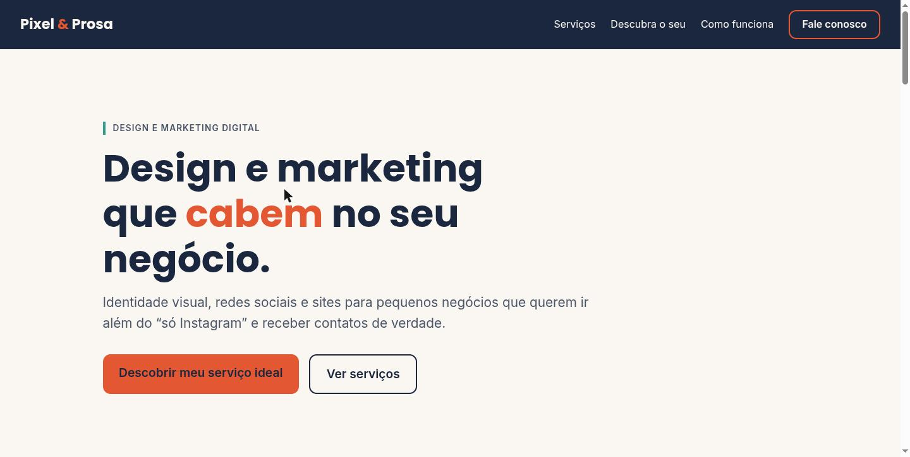
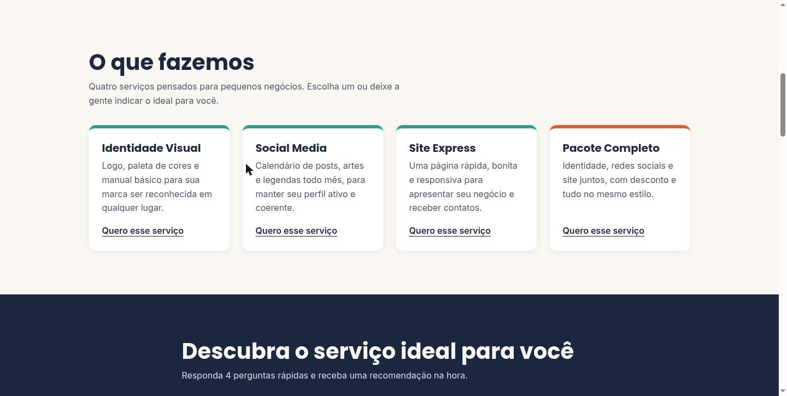
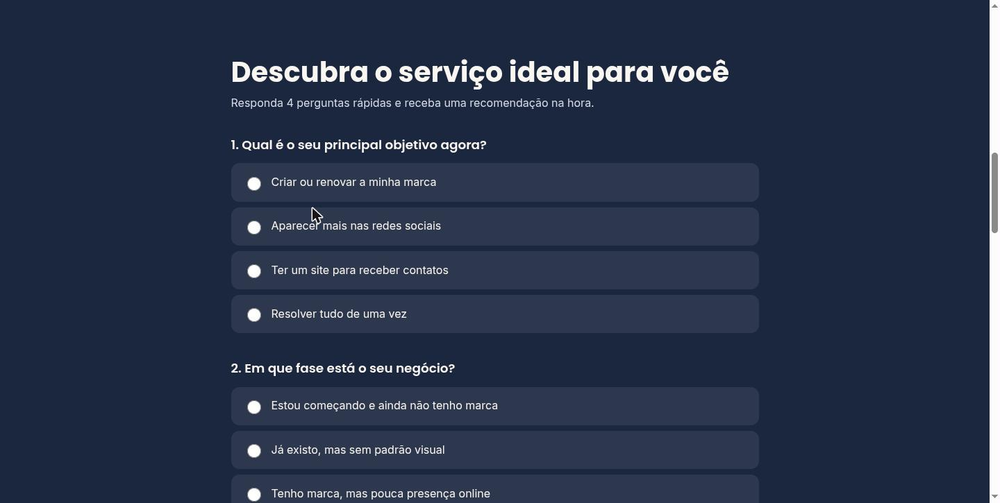
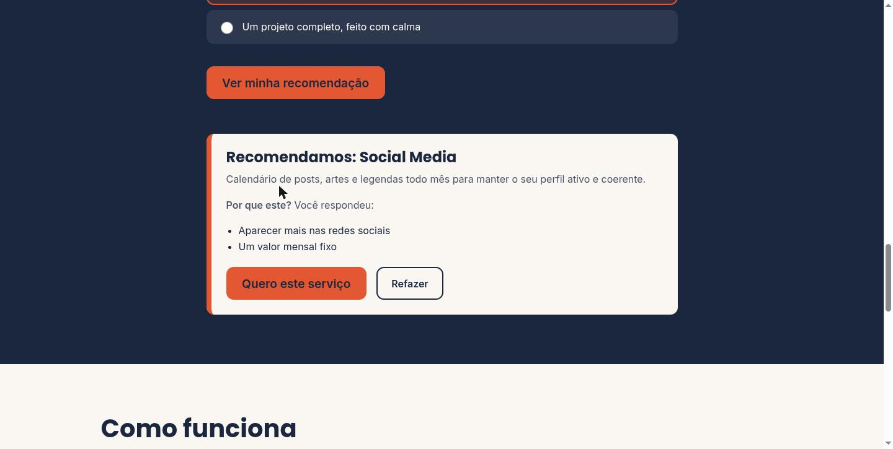
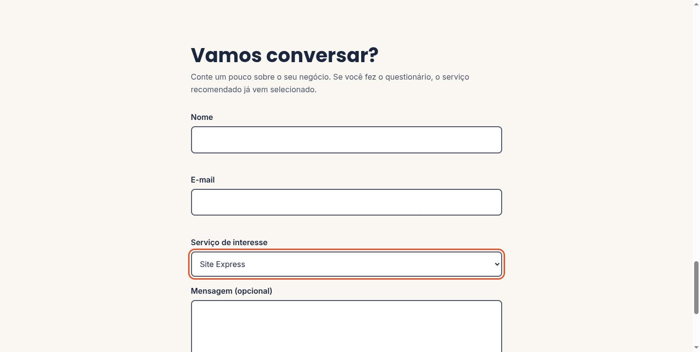
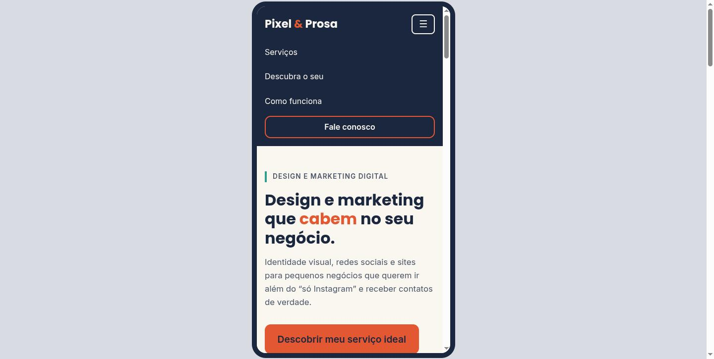
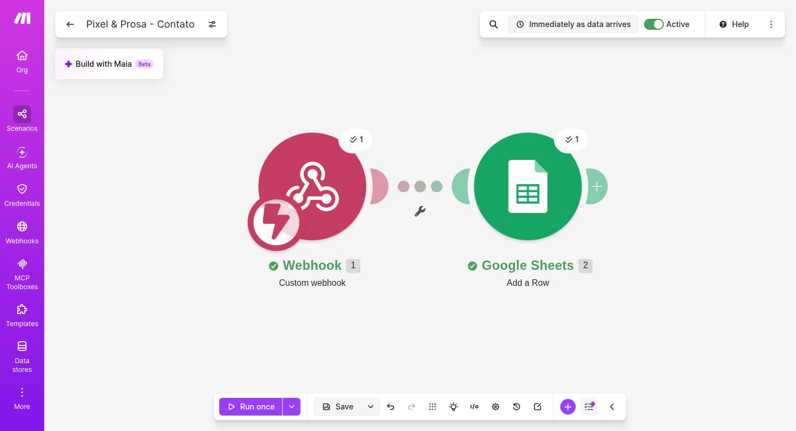
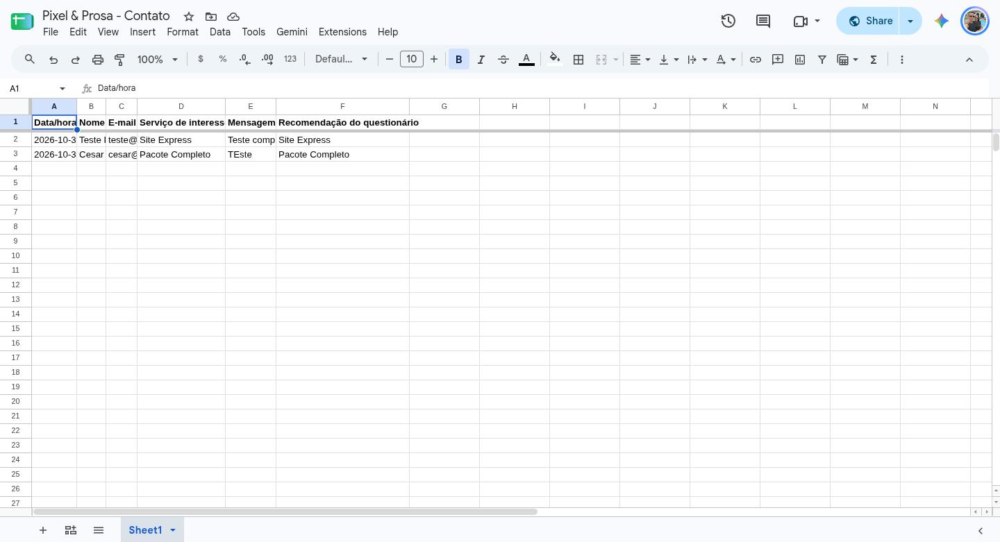

# Pixel & Prosa — Smart Web Experience

Site de um estúdio de design e marketing digital **fictício**, construído no **Webstudio** (no-code/low-code) e ampliado com **HTML, CSS e JavaScript próprios**, com um recurso inteligente (recomendador de serviços) e uma **automação no Make** que grava os contatos numa planilha.

- **Autor:** Cesar da Silva Escobar
- **Disciplina:** Padrões Web para No-Code e Low-Code
- **Site publicado:** https://pixel-and-prosa-uvhoy.wstd.io
- **Vídeo pitch (até 4 min):** _adicionar link_
- **Documento teórico:** _adicionar link/arquivo_

## 1. Problema

Uma pequena empresa de serviços só tem informações básicas nas redes sociais. Os clientes precisam entrar em contato manualmente para tirar dúvidas, pedir serviços ou demonstrar interesse. A empresa não tem equipe de desenvolvimento e precisa de uma solução rápida, barata e com possibilidade de evolução.

## 2. Solução e funcionalidades

- Página única, responsiva, com navegação por âncoras e menu mobile (hambúrguer).
- Apresentação de 4 serviços: Identidade Visual, Social Media, Site Express e Pacote Completo.
- **Recomendador de serviços:** 4 perguntas, pontuação por serviço e resultado explicado ("Por que este?").
- **Formulário de contato** com validação e envio automático para uma planilha (Make + Google Sheets).
- O serviço recomendado já vem selecionado no formulário.

## 3. Tecnologias e ferramentas

| Camada | Ferramenta |
|---|---|
| Plataforma no-code/low-code | Webstudio (estrutura, publicação, SEO) |
| Código personalizado | HTML, CSS e JavaScript em componentes *HTML Embed* |
| Automação | Make (Custom webhook + Google Sheets *Add a Row*) |
| Armazenamento dos contatos | Google Sheets |
| Fontes | Poppins e Inter (Google Fonts) |

## 4. Personalizações com padrões web

**HTML semântico**
- Estrutura `<header>`, `<nav>`, `<main>` com `<section>` (ids `hero`, `servicos`, `recomendador`, `como-funciona`, `contato`) e `<footer>`, definida no editor do Webstudio trocando a tag de cada elemento.
- Formulários com `<fieldset>`/`<legend>`, `<label>` associados e listas `<ul>`/`<ol>` para serviços e passos.

**CSS**
- Variáveis em `:root` (paleta, fontes, espaçamento, raio) usadas em todo o site.
- Layout com CSS Grid (`repeat(auto-fit, minmax(...))`), Flexbox e tamanhos fluidos com `clamp()`.
- Abordagem *mobile-first* com ponto de quebra em 768px.
- `:focus-visible` em todos os elementos e `prefers-reduced-motion` para desligar animações.

**JavaScript**
- Menu mobile com `aria-expanded` e rótulo dinâmico.
- Recomendador: soma pontos por serviço a partir de atributos `data-p` e escolhe o vencedor (empate favorece o serviço mais específico).
- Validação do formulário e envio ao webhook com `fetch`.

O código de cada trecho está na pasta [`codigo/`](codigo/).

## 5. Recurso inteligente e automação

1. **Recomendador (lógica própria em JavaScript, sem API externa):** cada opção de resposta vale pontos para um ou mais serviços; o serviço com mais pontos é recomendado e o site mostra quais respostas mais pesaram. A regra é explicável e funciona sem expor chaves de API.
2. **Automação no Make:** o formulário envia os campos `nome`, `email`, `servico`, `mensagem`, `recomendacao` e `enviadoEm` para um *Custom webhook*, que adiciona uma linha na planilha do Google Sheets.

> A URL do webhook **não** está neste repositório. Nos arquivos de código ela aparece como `COLE_AQUI_A_URL_DO_WEBHOOK`.

## 6. Responsividade e acessibilidade

- Teste em 390px de largura: sem rolagem horizontal, menu hambúrguer funcionando e serviços em uma coluna.
- Idioma da página `pt-BR`, um único `<h1>`, landmarks (`header`, `nav`, `main`, `footer`).
- Contraste verificado pela fórmula WCAG: textos principais acima de 4,5:1. Os botões coral usam texto grande em negrito (4,34:1, acima do mínimo de 3:1 para texto grande).
- Mensagens de erro com `role="alert"`, resultado do recomendador em `aria-live`, campos com `aria-invalid` e `aria-describedby`.

## 7. Prints

| | |
|---|---|
| **Início** |  |
| **Serviços** |  |
| **Recomendador (perguntas)** |  |
| **Recomendador (resultado)** |  |
| **Contato** |  |
| **Mobile com menu aberto** |  |
| **Cenário no Make** |  |
| **Planilha recebendo os contatos** |  |

## 8. Como acessar e testar

1. Abra https://pixel-and-prosa-uvhoy.wstd.io.
2. Em **Descubra o serviço ideal para você**, responda as 4 perguntas e clique em **Ver minha recomendação**.
3. Clique em **Quero este serviço**: o formulário de contato aparece com o serviço já selecionado.
4. Preencha nome e e-mail (pode ser fictício) e envie. A mensagem vira uma linha na planilha de contatos.
5. Em tela estreita (ou no modo dispositivo do navegador), teste o menu hambúrguer.

## 9. Limitações e aprendizados

- Os scripts dos *HTML Embed* só executaram no site publicado depois de ativar **Client Only** no componente; sem isso o formulário recarregava a página.
- O Head Slot do Webstudio traz um `<title>` padrão que sobrescrevia o título da página; foi preciso editá-lo.
- O navegador bloqueia a leitura da resposta do webhook (CORS), então o envio usa `mode: 'no-cors'` e o site não consegue confirmar o recebimento; a conferência é a linha aparecer na planilha.
- O recomendador é baseado em regras, não em modelo de linguagem; uma evolução natural seria um assistente com IA generativa por trás do Make.
- Projeto acadêmico: a empresa, os serviços e os textos são fictícios.

## 10. Estrutura do repositório

```
README.md
codigo/    HTML, CSS e JS de cada trecho do site (componentes HTML Embed)
prints/    capturas de tela usadas neste README
```
